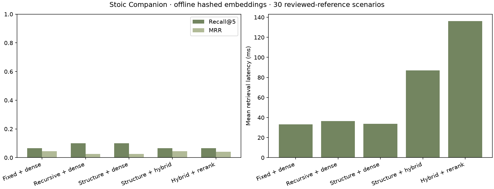

# Retrieval evaluation

## Verified semantic run — November 12, 2026

The completed current run uses **text-embedding-3-small**, the actual Ubuntu Qdrant 1.15.4 server and a shared model-specific embedding cache. All 30 questions are retrieved in each of five configurations. Three per configuration use real GPT-4.1-mini Responses (15 samples total); the remaining 135 rows use explicitly labeled templates. SQL source snapshots for this benchmark are isolated SQLite databases; the application's actual PostgreSQL corpus is verified separately in [the infrastructure audit](evidence/infrastructure-audit.json).

| Strategy | Recall@5 | MRR | Retrieval mean ms | Real GPT mean ms (N) | Estimated run cost USD |
|---|---:|---:|---:|---:|---:|
| Fixed + dense | 0.450 | 0.393 | 114.47 | 4847.62 (3) | 0.007593 |
| Recursive + dense | 0.433 | 0.415 | 80.82 | 6537.76 (3) | 0.009589 |
| Structure + dense | 0.433 | 0.415 | 85.41 | 5934.72 (3) | 0.009747 |
| Structure + hybrid | 0.350 | 0.205 | 135.24 | 7529.02 (3) | 0.015094 |
| Hybrid + lexical rerank | 0.250 | 0.194 | 156.52 | 6983.32 (3) | 0.011753 |

Final citation validity and quote validity were **1.000** in every configuration; all 15 sampled live generations passed, including any bounded repair. These rates measure displayed source-card integrity, not semantic faithfulness of all prose. Per-row provider, tokens, timings, original/expanded query and candidate scores are in [the raw results](../eval/live/results.json). The [generated report](../eval/live/report.md) and [chart](../eval/live/retrieval.png) preserve the same measurements. Total: 93,365 input and 10,268 output tokens, zero new embedding tokens from the warmed cache, estimated $0.053775 at configured prices. Setup, smoke and earlier runs are excluded, and this is not an account invoice. Failed outputs from the earlier semantic run remain in `eval/live-before-targeted-repair`.

Investigations before changing chunk sizes:

- Four Seneca reference IDs across three questions were absent from the actual source namespace. They were corrected to the real letter-and-paragraph IDs, with the exact old/new mapping in [reference-corrections.json](../eval/reference-corrections.json). A regression test and a pre-evaluation corpus-coverage check now reject missing reference IDs.
- The corrected [offline comparison](../eval/continuation-offline/report.md) still scored only 0.067–0.100 recall with hashed word vectors. Real semantic vectors improved retrieval on this particular set. That does not establish general performance on unseen questions.
- Hybrid fusion and the zero-API-cost lexical coverage reranker reduced both recall and MRR. The raw rankings allow inspection of cases where keyword overlap displaced semantic hits. This is a plausible cause, not a proven causal result from an independent ablation.
- No chunk sizes changed. All strategies retain original source-unit parents; fixed/recursive baselines compare child subdivision inside those parents, not arbitrary whole-book windows. The independent relevance judgments remain provisional and need outside human review.

The live local configuration uses structure-aware **dense retrieval without reranking**: strong MRR while preserving citation boundaries. Configuration was selected on this small benchmark; validate a held-out set before production. Generation latency includes structured validation and up to one targeted repair. Quote/citation guards were retained; rejected prose is never displayed as evidence.

Reproduce with `./tasks.ps1 evaluate-live`, or `python -m app.evaluate --provider openai --generation-provider openai --generation-samples 3 --qdrant-url http://127.0.0.1:6334 --output-dir eval/live` with the shared embedding cache configured. Increase `--generation-samples` to 30 only if a fully generated benchmark and its additional cost are intended. The normal `python -m app.evaluate` remains offline and reports template generation explicitly.

## Historical offline run

The following original results are retained for provenance. They predate the Seneca reference-ID correction; use the corrected offline report above for current comparisons. They are not the application's current semantic retrieval scores.

Measured locally using real Qdrant cosine search and BM25. Offline signed word-hash embeddings are a functional baseline, not OpenAI semantic quality. Answers use the labeled fixed demo template. No GPT quality or live answer latency claim is made.

All strategies preserve source-unit parents; fixed and recursive baselines change child subdivision within those same parents. This isolates segmentation, but is not a document-wide arbitrary-window baseline. The default target is 280 cl100k tokens. All share the same question set and corpus.

Reference passages were selected from the actual source sections with explicit editorial rationales in questions.json. They are provisional relevance judgments authored during implementation, not a blinded independent human evaluation. Broader acceptable passages may exist.

| Strategy | Recall@5 | MRR | Citation validity | Quote verification | Retrieval mean ms | Template answer mean ms | API cost USD |
|---|---:|---:|---:|---:|---:|---:|---:|
| Fixed + dense | 0.067 | 0.044 | 1.000 | 1.000 | 33.20 | 0.30 | 0.0000 |
| Recursive + dense | 0.100 | 0.026 | 1.000 | 1.000 | 36.60 | 0.33 | 0.0000 |
| Structure + dense | 0.100 | 0.026 | 1.000 | 1.000 | 33.72 | 0.29 | 0.0000 |
| Structure + hybrid | 0.067 | 0.044 | 1.000 | 1.000 | 87.09 | 0.28 | 0.0000 |
| Hybrid + rerank | 0.067 | 0.042 | 1.000 | 1.000 | 136.28 | 0.46 | 0.0000 |

Recall counts unique acceptable parent IDs returned within five, divided by all acceptable IDs. MRR uses the first acceptable hit. Citation and quote rates cover the displayed evidence cards only, not faithfulness of model prose. Cost is zero for the executed offline run. Latency includes embedding cache access, SQL corpus reads, BM25 index construction, Qdrant query, deduplication and reranking; disk caches are warm after ingestion.

Interpretation: low scores expose lexical mismatch between modern life scenarios and older English. Structure is selected for reliable citation boundaries; hybrid and overlap reranking are configurable, not claimed universally superior. Run the same benchmark with EMBEDDING_PROVIDER=openai and a key before judging production semantic retrieval. The harness intentionally retains template generation to isolate retrieval costs. Live generation latency and prose faithfulness still require a credentialed evaluation.

Reproduce: `python -m app.evaluate` from backend (or set PYTHONPATH=backend). Results JSON includes every query, rank, score and timing. Never compare these numbers to a semantic embedding model without labeling the model difference.
