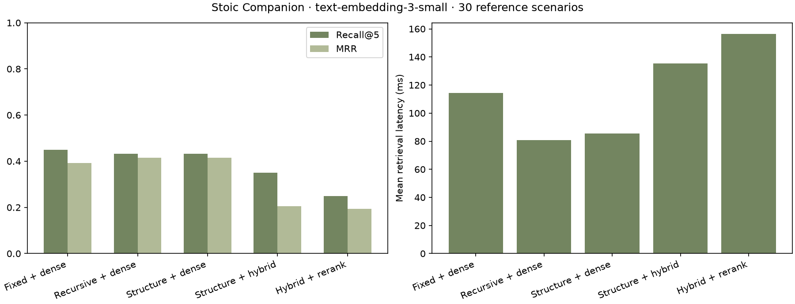

# Retrieval evaluation

Measured using text-embedding-3-small, Qdrant server cosine search and separate BM25. Source SQL is an isolated SQLite snapshot per strategy, not the application's PostgreSQL database. Generation provider: openai; up to 3 real GPT samples per strategy when enabled. Remaining rows explicitly use fixed templates.

All strategies preserve source-unit parents; fixed and recursive baselines change child subdivision within those same parents. This isolates segmentation, but is not a document-wide arbitrary-window baseline. The default target is 280 cl100k tokens. All share the same question set and corpus.

Reference passages were selected from the actual source sections with explicit editorial rationales in questions.json. They are provisional relevance judgments authored during implementation, not a blinded independent human evaluation. Broader acceptable passages may exist.

| Strategy | Recall@5 | MRR | Citation validity | Quote verification | Retrieval mean ms | Real GPT mean ms (N) | API cost USD |
|---|---:|---:|---:|---:|---:|---:|---:|
| Fixed + dense | 0.450 | 0.393 | 1.000 | 1.000 | 114.47 | 4847.62 (3) | 0.007593 |
| Recursive + dense | 0.433 | 0.415 | 1.000 | 1.000 | 80.82 | 6537.76 (3) | 0.009589 |
| Structure + dense | 0.433 | 0.415 | 1.000 | 1.000 | 85.41 | 5934.72 (3) | 0.009747 |
| Structure + hybrid | 0.350 | 0.205 | 1.000 | 1.000 | 135.24 | 7529.02 (3) | 0.015094 |
| Hybrid + rerank | 0.250 | 0.194 | 1.000 | 1.000 | 156.52 | 6983.32 (3) | 0.011753 |

Recall counts unique acceptable parent IDs returned within five, divided by all acceptable IDs. MRR uses the first acceptable hit. Citation and quote rates include the labeled template rows and cover source-card integrity, not prose faithfulness. Per-row provider and usage are recorded in results.json. Cost includes newly requested corpus/query embeddings and generation, at configured price estimates; cache hits cost zero, and shared embedding cache prevents repeat embedding across strategies. Latency includes SQL, Qdrant, lexical indexing and deduplication with warm caches.

Interpretation: inspect per-question rankings before attributing low scores to chunk sizes. Reference incompleteness, historical vocabulary, query expansion, a lexical reranker and parent-ID coverage can all affect these metrics. Structure is selected for citation boundaries; no strategy is claimed universally superior. No result in this report establishes unmeasured model quality or external human review.

Reproduce: `python -m app.evaluate` from backend (or set PYTHONPATH=backend). Results JSON includes every query, rank, score and timing. Never compare these numbers to a semantic embedding model without labeling the model difference.